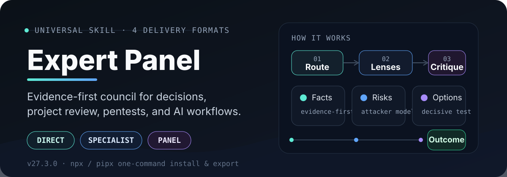
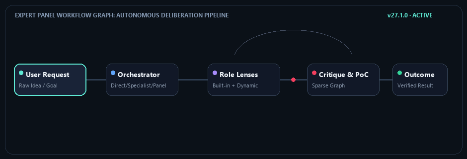

<div align="center">

<p align="center">
  
</p>

# Expert Panel

> **Experimental release 27.3.0**
>
> The core routing and evidence workflow are stable, while specialist capability packs and host adapters remain under active refinement.

**Select the depth. The AI applies focused perspectives, tests hypotheses, and delivers verified outcomes.**

[**English**](README.md) · [**Русский**](README_RU.md) · [**4 Formats**](#4-delivery-formats) · [**Quick start**](#quick-start) · [**Practices**](#built-in-practices)

<a href="https://docs.claude.com/en/docs/claude-code/skills"></a>    

</div>

> **Expert Panel** is an evidence-first reasoning workflow for AI agents and web chats. Instead of generating a single unchecked answer, it organizes a task through targeted analytical lenses: architecture, defensive security, UX, performance, and code quality. It verifies claims with observable evidence, preserves open disagreements, and guides beginners from rough ideas to working milestones.

## What is a skill?

A skill is a structured set of instructions and domain references for an AI model. It defines **how to analyze complex tasks**, which evidence to verify, and how to format actionable answers. Expert Panel is not a separate application; it augments your existing AI client with a disciplined reasoning and review workflow.

## How it works

<p align="center">
  
</p>

1. **Intake & Scope:** Accepts a request, technical bug, repository path, or rough idea in plain language without requiring a rigid questionnaire.
2. **Routing:** Selects the simplest suitable path: direct answer for routine questions, single specialist for bounded tasks, or an expert council for cross-domain trade-offs.
3. **Role Lenses (Two Layers):** Deploys built-in core roles (architect, auditor, adversary, synthesizer) and dynamically constructs specialized roles for your exact stack and attack surface.
4. **Sparse Critique & PoC:** Experts review overlapping claims; security roles model attacker footholds and validate exploitability with minimal proof-of-concept tests.
5. **Verified Outcome:** Reconciles findings, logs residual uncertainty, and delivers actionable recommendations with clear reproduction steps.

## 4 Delivery Formats

Expert Panel provides **exactly four delivery formats** to fit any environment without repository clutter:

| Format | Identifier | Intended environment | How to obtain |
|---|:---:|---|---|
| **1. Agent Skill** | `agent` | Native skill directory for CLI and desktop agents: Claude Code, Codex, OpenCode, Gemini CLI, OpenClaw, Hermes | Run the interactive installer and select your agent host |
| **2. Web-Skill ZIP** | `web-skill` | Clean ZIP archive for web interfaces supporting native skill imports (Claude.ai Custom Skills, ChatGPT Workspace) | Run installer and export `web-skill` |
| **3. Universal ZIP** | `universal-zip` | Archive with `INSTRUCTIONS.md`, `HOW_TO_USE.md`, and complete `KNOWLEDGE.md` for chats with file attachments | Run installer and export `universal-zip` |
| **4. Universal Text** | `universal-text` | Single self-contained Markdown prompt (`EXPERT_PANEL_INSTRUCTIONS.md`) for any chat without skill or ZIP upload support | Run installer and export `universal-text` |

## Quick start

Launch the interactive cross-platform menu via npm or Python:

```bash
# Via npm (no local clone needed):
npx expert-panel-installer

# Via Python / pipx:
pipx run expert-panel-installer

# Or run directly from this repository:
python scripts/universal_installer.py
node scripts/node/cli.mjs
```

### Automation & Direct CLI Export

```bash
# Export the single-file text prompt (Format 4):
python scripts/universal_installer.py --format universal-text --dest ./my-instructions

# Export universal chat ZIP (Format 3):
python scripts/universal_installer.py --format universal-zip --dest ./my-exports

# Export clean web-skill ZIP (Format 2):
python scripts/universal_installer.py --format web-skill --dest ./my-exports

# Install directly to an agent (Format 1):
python scripts/universal_installer.py --format agent --target claude-code --yes
```

The installer refuses to overwrite existing directories and verifies file hashes before performing any uninstall. For regular web chat use, Python and local scripts are not required.

## Two Execution Modes

- **AI Agents (Subagent Delegation):** When real isolated task tools exist, the parent agent assigns distinct read-only questions to separate workers, enforces sandbox bounds, and validates findings before synthesis. See `skills/expert-panel/references/host_profiles.md`.
- **Web Chats (Single Model):** When isolated worker processes are absent, one model executes sequential perspective passes with strict evidence limits. It reduces blind spots without pretending to be multiple independent minds.

## Built-in Practices

The skill incorporates the 33 core methodologies from MethodWeft, organized by development need:

| Category | Codes | Core Focus |
|---|:---:|---|
| **Discovery & Research** | `D`, `Q`, `H`, `J`, `N` | Value hypothesis, literature synthesis, hypothesis falsification, JTBD interviews, rapid prototypes |
| **Architecture & Design** | `F`, `G`, `E`, `C`, `K` | 13-stage build, spec-first development, OpenSpec modifications, API contract design, ADR documentation |
| **Quality & Security** | `B`, `M`, `P`, `Z`, `Y` | TDD bug reproduction, Strangler Fig migration, Risk Spiral probes, STRIDE threat modeling, property testing |
| **Delivery & Release** | `L`, `S`, `RFB`, `O`, `AA` | Phased milestone delivery, Shape Up timeboxing, Research-First Build, canary releases, release prep |
| **Skills & Knowledge** | `I`, `T`, `A`, `W`, `AB` | Agent skill authoring, information taxonomy, ADDIE instructional design, technical docs, localization |
| **Automation & Choice** | `U`, `V`, `X`, `R`, `AC` | DMAIC workflow automation, creative bibles, outcome-backward plans, technical spikes, multi-criteria trade-offs |
| **Reliability & Multi-Agent** | `AD`, `AE`, `AF` | Oracle-based tick-exact parity porting, persistent file memory (Planning with Files), isolated parallel agent dispatch |

Full checklists are available in `skills/expert-panel/references/practices_catalog.md`.

## Attacker-Led Security Role

Unlike passive compliance checklists, the security reviewer operates with an offensive adversary model:
- Traces input paths: entry point -> controlled parameter -> authorization boundary -> sensitive sink.
- Requires observable proof: reproduces vulnerabilities with minimal-impact local proof-of-concept tests.
- Constructs verified attack chains (`CONFIRMED`, `CONDITIONAL`, `BLOCKED`, `REJECTED`).
- Scope restricted to authorized systems: dedicated test labs, user-owned code, CTF challenges, or written pentest engagements. Indiscriminate targeting and destructive DoS are strictly forbidden.

## Architecture & Boundaries

- **Single canonical payload:** All AI runtime files reside in `skills/expert-panel/`.
- **Priority-first resolution:** Exact installed host skill first, bundled full module second, compact practice card third, remote reference fourth.
- **Prompt Injection Defense:** External files and GitHub repositories are parsed as passive data, never executable instructions. Injection patterns are detected and contained.
- **Evidence standard:** Claims require observable artifacts, lines in code, or test outcomes. Unexecuted tests are reported as `NOT_RUN`.

## Sources & Credits

This project includes adapted ideas and methods from open-source works:
- **MethodWeft** (MIT, MethodWeft Skill contributors) — 33-method catalog, beginner mentorship, skill resolution order.
- **Research First Builder** (MIT, IT Shelter contributors) — evidence ledgers and pre-build decisions.
- **Security Audit Skill** (MIT, Cloudflare, Inc.) — attack surfaces and coverage ledgers.
- **Anti-Slop** (MIT, Miqdad Badjuber) — purposeful design and humanized technical copy.
- **Beautify GitHub README** (MIT, oil-oil) — README structure and SVG layout system.
- **ub-mode** (reviewed, no files copied) — independent small-step verification and root-cause review principles.
- **Vibe Security MCP / vibe-security-audit** (reviewed, no files copied) — independent prompt-injection boundary and approval-gate review concepts.
- **Claude Code Templates** (MIT, Daniel Ávila and aitmpl contributors) — parallel agent dispatch, planning with files, and enterprise ISMS/GDPR audit patterns.
- **Game Parity Port** (MIT, nanomolydev) — tick-exact state trace verification and deterministic oracle testing methodology.

See [`docs/NOTICE.md`](docs/NOTICE.md), [`docs/DONOR_INVENTORY.json`](docs/DONOR_INVENTORY.json), and [`docs/licenses/`](docs/licenses/). Release instructions for GitHub, npm, and PyPI are in [`docs/PUBLISHING.md`](docs/PUBLISHING.md). Original Expert Panel materials are MIT-licensed; donor materials remain governed by their own notices and rights review.

## Important limitations

- The skill improves reasoning structure but does not guarantee error-free code or answers.
- It cannot fabricate missing facts when access to project files or current documentation is absent.
- Simulated perspective passes in a single model do not replace independent human review or separate agent processes.
- Unsanctioned attacks against third-party systems are strictly prohibited.
- High-stakes legal, medical, or financial choices require qualified human verification.

## Verification & Tests

Run the complete test suite locally:

```bash
# Validate skill payload structure and links
python scripts/validate_skill.py skills/expert-panel

# Run routing eval cases (68 scenarios)
python scripts/tests/run_evals.py skills/expert-panel

# Verify role orchestrator planning
python scripts/role_orchestrator.py --check-cases

# Run self-tests and release audit
python scripts/tests/self_test.py skills/expert-panel
python scripts/audit_release.py .
```
