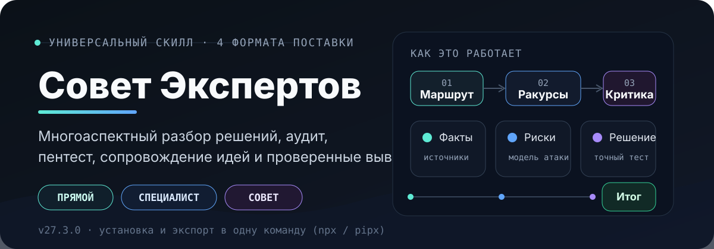
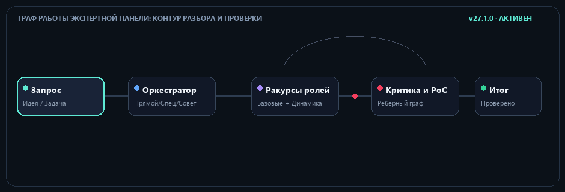

<div align="center">

<p align="center">
  
</p>

# Совет Экспертов (Expert Panel)

> **Экспериментальный релиз 27.3.0**
>
> Ядро маршрутизации и evidence-first workflow стабилизированы, а специализированные capability packs и host adapters продолжают дорабатываться.

**Вы задаёте задачу. ИИ подбирает ракурсы анализа, проверяет гипотезы и выдаёт подтверждённый результат.**

[**English**](README.md) · [**Русский**](README_RU.md) · [**4 формата**](#4-формата-поставки) · [**Быстрый старт**](#быстрый-старт) · [**Практики**](#встроенные-практики)

<a href="https://docs.claude.com/en/docs/claude-code/skills"></a>    

</div>

> **Совет Экспертов** : доказательный рабочий процесс для ИИ-агентов и веб-чатов. Вместо одного непроверенного ответа система организует разбор задачи через целевые ракурсы анализа: архитектура, наступательная безопасность, удобство интерфейса, производительность и качество кода. Выводы подкрепляются фактами, нерешённые противоречия остаются открытыми, а новичок получает помощь в переходе от сырой идеи к первому рабочему результату.

## Что такое скилл

Скилл : структурированный набор инструкций и предметных методик для модели ИИ. Он определяет, **как разбирать сложные задачи**, какие доказательства проверять и в каком виде выдавать результат. Expert Panel не является отдельной программой; он дополняет ваш ИИ проверенным рабочим процессом анализа и аудита.

## Как это работает

<p align="center">
  
</p>

1. **Вход и границы:** Принимает задачу, технический сбой, путь к репозиторию или сырую идею простыми словами без заполнения длинных опросников.
2. **Маршрутизация:** Выбирает минимально достаточный путь: прямой ответ для простых вопросов, один специалист для локальной задачи или совет экспертов для многоаспектных компромиссов.
3. **Два слоя ролей:** Задействует базовые управляющие роли (архитектор, аудитор, оппонент, синтезатор) и динамически создаёт специализированные ракурсы под конкретный стек и поверхность атаки.
4. **Критика и PoC:** Эксперты проверяют пересекающиеся утверждения; специалист по безопасности моделирует действия атакующего и подтверждает уязвимости минимальным воспроизводимым тестом.
5. **Проверенный результат:** Сводит выводы воедино, фиксирует остаточную неопределённость и даёт практические рекомендации с точными местами в коде.

## 4 формата поставки

Expert Panel предоставляет **ровно четыре формата поставки** под любой сценарий без лишних файлов в репозитории:

| Формат | Код | Среда применения | Как получить |
|---|:---:|---|---|
| **1. Скилл для ИИ-агентов** | `agent` | Папка скилла для агентных сред: Claude Code, Codex, OpenCode, Gemini CLI, OpenClaw, Hermes | Запустить установщик и выбрать платформу агента |
| **2. ZIP для веб-чатов со скиллами** | `web-skill` | Чистый ZIP-архив для интерфейсов с нативной поддержкой импорта скиллов (Claude.ai Custom Skills, ChatGPT Workspace) | Запустить установщик и выбрать `web-skill` |
| **3. Универсальный ZIP для веб-чатов** | `universal-zip` | Архив с файлами `INSTRUCTIONS.md`, `HOW_TO_USE.md` и базой знаний `KNOWLEDGE.md` для чатов с прикреплением файлов | Запустить установщик и выбрать `universal-zip` |
| **4. Одиночная текстовая инструкция** | `universal-text` | Один цельный Markdown-файл (`EXPERT_PANEL_INSTRUCTIONS.md`) для чатов без поддержки скиллов и без загрузки ZIP | Запустить установщик и выбрать `universal-text` |

## Быстрый старт

Запустите универсальное интерактивное меню через npm или Python:

```bash
# Из экспериментального GitHub-репозитория (работает до публикации в реестрах):
git clone https://github.com/Jecky5675/expert-panel.git
cd expert-panel
python scripts/universal_installer.py

# Или напрямую из локальной копии:
python scripts/universal_installer.py
node scripts/node/cli.mjs

# Команды для реестров (станут доступными после публикации npm/PyPI):
# npx expert-panel-installer
# pipx run expert-panel-installer

> Имена npm- и PyPI-пакетов уже указаны в metadata, но экспериментальный релиз пока доступен только через GitHub. Для работы npx/pipx сначала нужно завершить публикацию в реестры.
```

### Автоматизация и прямой экспорт через CLI

```bash
# Экспортировать одиночную инструкцию в Markdown (Формат 4):
python scripts/universal_installer.py --format universal-text --dest ./my-instructions

# Экспортировать универсальный ZIP для чата (Формат 3):
python scripts/universal_installer.py --format universal-zip --dest ./my-exports

# Экспортировать чистый ZIP скилла для загрузки (Формат 2):
python scripts/universal_installer.py --format web-skill --dest ./my-exports

# Установить для агента напрямую (Формат 1):
python scripts/universal_installer.py --format agent --target claude-code --yes
```

Установщик защищает существующие файлы от случайной перезаписи и проверяет хеши перед удалением. Для работы в обычном веб-чате Python и запуск скриптов не требуются.

## Два режима выполнения ролей

- **ИИ-агенты (делегирование субагентам):** При наличии реальных инструментов запуска задач родительский агент назначает проверяющим изолированные вопросы только для чтения, контролирует границы песочницы и проверяет доказательства перед сведением ответа. Подробнее: `skills/expert-panel/references/host_profiles.md`.
- **Веб-чаты (одна модель):** При отсутствии отдельных процессов одна модель последовательно применяет разные ракурсы со строгими ограничениями на объём свидетельств. Это устраняет слепые зоны, не выдавая себя за группу независимых экспертов.

## Встроенные практики

Скилл объединяет 33 ключевые методики из MethodWeft, сгруппированных по инженерным задачам:

| Категория | Коды | Основной фокус |
|---|:---:|---|
| **Исследование и продукт** | `D`, `Q`, `H`, `J`, `N` | Проверка гипотезы ценности, синтез литературы, опровержение гипотез, интервью JTBD, быстрые эксперименты |
| **Архитектура и требования** | `F`, `G`, `E`, `C`, `K` | Полный цикл из 13 шагов, разработка от требований (Spec-first), правка кода (OpenSpec), контракты API, фиксация решений (ADR) |
| **Качество и безопасность** | `B`, `M`, `P`, `Z`, `Y` | Воспроизведение багов по TDD, безопасная миграция, спираль рисков, моделирование угроз STRIDE, проверка граничных входов |
| **Поставка и релизы** | `L`, `S`, `RFB`, `O`, `AA` | Поэтапные поставки, метод Shape Up с ограничением по времени, исследование до сборки (RFB), канареечные релизы, подготовка релиза |
| **ИИ-скиллы и знания** | `I`, `T`, `A`, `W`, `AB` | Создание и тестирование скиллов, архитектура информации, методика обучения ADDIE, техническая документация, локализация |
| **Автоматизация и решения** | `U`, `V`, `X`, `R`, `AC` | Автоматизация рутины DMAIC, сценарии и творческие концепции, планирование от цели назад, технические спайки, матрица альтернатив |
| **Надёжность и мультиагентность** | `AD`, `AE`, `AF` | Точное потиковое портирование с оракулом (Parity Porting), файловая память сессий (Planning with Files), параллельная изолированная диспетчеризация (Parallel Dispatch) |

Краткий каталог с пошаговыми алгоритмами доступен в `skills/expert-panel/references/practices_catalog.md`.

## Наступательная роль безопасности

В отличие от пассивных списков требований, проверяющий безопасности действует как атакующий специалист:
- Отслеживает путь данных: входная точка -> контролируемый параметр -> проверка прав -> критическая операция.
- Требует практического подтверждения: воспроизводит уязвимости минимальным безопасным тестом (PoC).
- Выстраивает цепочки атак (`CONFIRMED`, `CONDITIONAL`, `BLOCKED`, `REJECTED`).
- Работает строго по санкционированным целям: тестовые стенды, учебные лаборатории, собственный код, CTF или явное задание на пентест. Массовые сканирования и деструктивный DoS исключены.

## Архитектурные правила

- **Один канонический payload:** Все исполняемые файлы скилла находятся в папке `skills/expert-panel/`.
- **Строгий приоритет разрешения:** Сначала точный установленный скилл хоста, затем встроенный полный модуль, затем краткая карточка практики, и только потом внешняя ссылка.
- **Защита от Prompt Injection:** Текст из внешних репозиториев и сайтов читается как пассивные данные, а не как инструкции. Попытки внедрения команд распознаются и изолируются.
- **Стандарт свидетельств:** Каждый вывод должен опираться на код, источники или реальный запуск тестов. Невыполненные проверки явно помечаются как `NOT_RUN`.

## Источники и благодарности

В проекте переработаны и адаптированы решения из открытых проектов:
- **MethodWeft** (MIT, авторы MethodWeft Skill) : каталог из 33 методик, принципы наставничества, приоритеты разрешения скиллов.
- **Research First Builder** (MIT, авторы IT Shelter) : журнал доказательств и принятие решений до реализации.
- **Security Audit Skill** (MIT, Cloudflare, Inc.) : классификация поверхностей атаки и карты покрытия.
- **Anti-Slop** (MIT, Miqdad Badjuber) : функциональный дизайн без шаблонного ИИ-мусора и человечный тон текстов.
- **Beautify GitHub README** (MIT, oil-oil) : структура документации и модули вёрстки SVG.
- **ub-mode** (проверен, файлы не копировались) : независимые принципы малых проверяемых шагов и поиска корневой причины.
- **Vibe Security MCP / vibe-security-audit** (проверены, файлы не копировались) : независимые идеи границы prompt injection и явного approval-gate.
- **Claude Code Templates** (MIT, авторы Daniel Ávila и aitmpl) : параллельная диспетчеризация агентов, файловая память сессий и корпоративный аудит соответствия (ISMS/GDPR).
- **Game Parity Port** (MIT, nanomolydev) : методология потиковой верификации и детерминированного сравнительного тестирования логики с оракулом.

Подробности: [`docs/NOTICE.md`](docs/NOTICE.md), [`docs/DONOR_INVENTORY.json`](docs/DONOR_INVENTORY.json), [`docs/licenses/`](docs/licenses/). Инструкция по подготовке GitHub-релиза и публикации npm/PyPI: [`docs/PUBLISHING.md`](docs/PUBLISHING.md). Авторские материалы Expert Panel лицензированы MIT; материалы доноров регулируются отдельными notices и требуют проверки прав.

## Важные ограничения

- Скилл улучшает структуру рассуждений, но не гарантирует безошибочный код или абсолютно верный ответ.
- Он не придумывает отсутствующие факты, если исходные файлы или документация не были предоставлены.
- Несколько ракурсов одной модели не заменяют реальный аудит независимым экспертом или отдельные процессы.
- Атаки на сторонние сервисы без явного письменного разрешения исключены.
- Важные юридические, финансовые и медицинские решения требуют верификации профильным специалистом.

## Проверка и тестирование

Запуск полного локального набора тестов:

```bash
# Проверка структуры скилла и ссылок
python scripts/validate_skill.py skills/expert-panel

# Прогон сценариев маршрутизации (68 тестов)
python scripts/tests/run_evals.py skills/expert-panel

# Проверка планировщика двухслойных ролей
python scripts/role_orchestrator.py --check-cases

# Запуск самопроверок и аудита репозитория
python scripts/tests/self_test.py skills/expert-panel
python scripts/audit_release.py .
```
